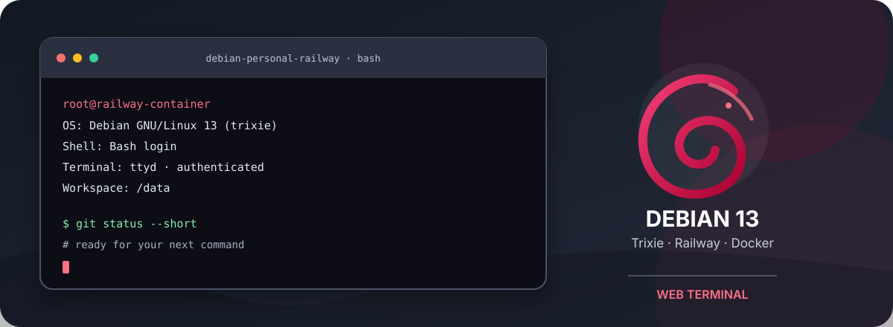
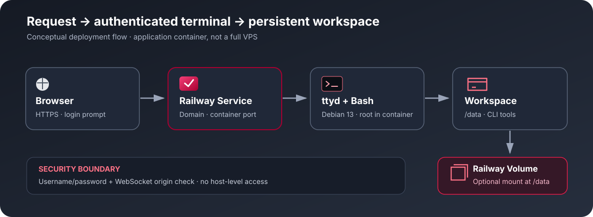

<div align="center">

<a href="https://www.debian.org/"></a>

# Debian Personal Railway

<p>
  <a href="https://github.com/DURIAN-ORGANISASI/debian-railway/actions/workflows/docker-build.yml"></a>
  
  
  
  <a href="LICENSE"></a>
</p>

<p><a href="README.md">🇮🇩 Bahasa Indonesia</a> · <a href="README.en.md">🇬🇧 English</a></p>

<p><strong>Debian 13 terminal in your browser, ready to deploy on Railway.</strong><br>
Use Bash, everyday CLI tools, an automatic system information banner, and optional persistent storage.</p>

<p>
  <a href="#try-it">Quick start</a> ·
  <a href="#features">Features</a> ·
  <a href="#architecture-overview">Architecture</a> ·
  <a href="#deployment-guide">Deployment guide</a> ·
  <a href="#persistent-storage">Storage</a> ·
  <a href="#privacy-and-security">Privacy &amp; security</a> ·
  <a href="#development">Development</a> ·
  <a href="#sources-attribution-and-license">Sources &amp; license</a> ·
  <a href="#contributing">Contributing</a> ·
  <a href="#project-security">Security</a>
</p>

</div>

---



<p align="center"><sub>Original documentation illustration; not an official Debian or Railway screenshot.</sub></p>

> [!WARNING]
> **This is not a full VPS.** Railway runs an application container, not a virtual server with host access, a desktop GUI, or guaranteed full systemd support. The web terminal provides a root shell inside the container. Use a strong password and remember that anyone who can sign in has high privileges within that container.

## Try it

1. Open the [Debian Personal Railway repository](https://github.com/DURIAN-ORGANISASI/debian-railway).
2. In Railway, choose **New Project → Deploy from GitHub Repo**, then select this repository.
3. Make sure the build uses the `Dockerfile` at the repository root.
4. Add `TERMINAL_USER` and `TERMINAL_PASSWORD` under **Railway → Service → Variables**.
5. Wait for deployment, then open **Settings → Networking → Generate Domain**.
6. Visit the domain and sign in. To keep files across redeploys, follow [Persistent storage](#persistent-storage).

## Features

- **Debian 13 (Trixie)** base image.
- Browser terminal powered by **`ttyd` 1.7.7** with username/password authentication.
- Supports **AMD64 and ARM64** using the matching ttyd binary.
- **Bash login shell** with an automatic system information banner.
- System details include distribution, kernel, architecture, uptime, CPU, memory, disk, shell, and timezone.
- Common CLI tools: Git, curl, Python 3, pip/venv, compiler/build tools, and shell utilities.
- Initial working directory **`/data`**, with optional Railway Volume support.
- Default timezone **`Asia/Jakarta`**.
- WebSocket Origin checking enabled; ttyd logging suppresses NOTICE messages that may include credential fields.
- GitHub Actions builds the image and checks terminal responses as well as credentials in logs.

## Architecture overview



Terminal flow:

1. The browser opens the HTTPS domain provided by Railway.
2. `ttyd` requests a username and password before opening the terminal session.
3. Bash login shell starts and displays the system banner.
4. Commands run inside the Debian container with `/data` as the initial working directory.
5. An optional Railway Volume mounted at `/data` keeps files available after container recreation.

## Deployment guide

### 1. Deploy on Railway

1. Create or open a Railway project.
2. Select **New Project → Deploy from GitHub Repo**, then choose `DURIAN-ORGANISASI/debian-railway`.
3. Build using the `Dockerfile` at the repository root. A custom Start Command is usually unnecessary because the image defines an `ENTRYPOINT`.
4. Add the required variables shown below.
5. Inspect **Build Logs** and **Deploy Logs** for build and runtime results.
6. Create a domain under **Settings → Networking → Generate Domain**.
7. Visit the domain and sign in when prompted.

### 2. Railway variables

Under **Railway → Service → Variables**, add:

```dotenv
TERMINAL_USER=REPLACE_WITH_UNIQUE_USERNAME
TERMINAL_PASSWORD=REPLACE_WITH_RANDOM_PASSWORD_AT_LEAST_24_CHARACTERS
TZ=Asia/Jakarta
```

| Variable | Required | Description |
| --- | --- | --- |
| `TERMINAL_USER` | Yes | Login username; must not contain a colon (`:`). |
| `TERMINAL_PASSWORD` | Yes | Unique password, at least 16 characters; 24–40 characters or longer is recommended. |
| `TZ` | No | Timezone; defaults to `Asia/Jakarta`. |
| `PORT` | Automatic | Railway provides the service port. Do not hardcode it in Variables; the image uses 8080 as a local fallback. |

A local template is available in [`.env.example`](.env.example). It is not a place for production credentials. Never commit real passwords, tokens, or API keys. If a password leaks, update `TERMINAL_PASSWORD` in Railway Variables and restart or redeploy the service.

### 3. Use the terminal

After signing in, the terminal opens Bash with `/data` as the working directory. The system banner appears automatically in new login sessions.

Example commands:

```bash
cat /etc/os-release
python3 --version
git --version
pwd
date
df -h /data
```

The shell runs as root **inside the container**, not as root on the Railway host. Git, Python, pip/venv, curl, and compiler tools are installed in the image. `fastfetch` is installed when available in Debian's package repositories; the banner has a fallback display if the tool is unavailable.

## Persistent storage

The container filesystem is not guaranteed to survive container recreation or redeployment. To preserve working files:

1. Open **Railway → Service → Settings → Volumes → Add Volume**.
2. Set the **Mount Path** to exactly `/data`.
3. Save files you need to keep inside `/data`.

Files outside the mount point are not automatically persistent. A Volume is not a backup replacement—copy important files somewhere safe regularly.

## Troubleshooting

| Problem | What to check |
| --- | --- |
| Deployment stops immediately | Set `TERMINAL_USER` without a colon and use a password at least 16 characters long. Check Deploy Logs. |
| Build cannot download ttyd or packages | Check build access to GitHub Releases and Debian package repositories. |
| Domain opens but terminal does not appear | Confirm the service is active, the domain maps to the right service, and the app listens on Railway's `PORT`. |
| Browser terminal/WebSocket fails | Open the HTTPS domain directly, avoid embedding it from another origin, and inspect runtime logs. |
| Banner is missing | Open a new session and ensure an interactive Bash login shell is used. |
| Files disappear after redeploy | Mount a Volume exactly at `/data` and keep files inside it. |
| Password needs to change | Update `TERMINAL_PASSWORD` in Railway Variables, then restart or redeploy the service. |

## Privacy and security

- **Protect the public domain.** Use a strong, unique password. Consider a trusted access layer if the terminal handles sensitive data.
- **Root privileges inside the container.** Commands have elevated privileges within the container. Review commands carefully; this is not root access to the Railway host.
- **Protect credentials.** Never put passwords, API keys, bot tokens, or private configuration in the repository, screenshots, or public logs.
- **ttyd logs.** ttyd runs at debug level 3 to suppress NOTICE messages that may include credential fields. ERROR/WARN messages remain enabled; this is not a complete security guarantee.
- **WebSocket Origin.** `--check-origin` restricts WebSocket connections from mismatched browser origins but does not replace authentication.
- **Volumes.** Only data at the configured mount point persists according to the Volume setup. Protect project access and backups.
- **Platform limits.** Full systemd, Docker-in-Docker, host-kernel access, desktop GUI, and all traditional daemons are not guaranteed.
- **Upstream sources.** Builds require network access to the Debian image, GitHub Releases, and package repositories. Upstream availability can change.

## Development

Clone the repository and build the image locally:

```bash
git clone https://github.com/DURIAN-ORGANISASI/debian-railway.git
cd debian-railway
docker build --tag debian-personal-railway .
```

GitHub Actions builds the image and runs a smoke test: the container must serve its authenticated terminal page, and logs must not contain the test password or its Base64 form. Passing CI does not prove that a live Railway deployment is successful.

### Repository structure

```text
debian-railway/
├── Dockerfile
├── entrypoint.sh
├── system-banner.sh
├── .dockerignore
├── .gitignore
├── .env.example
├── LICENSE
├── README.md
├── README.en.md
├── CONTRIBUTING.md
├── SECURITY.md
├── docs/
│   ├── hero.id.svg
│   ├── hero.en.svg
│   ├── architecture.svg
│   ├── architecture.en.svg
│   └── SOURCES.md
└── .github/
    └── workflows/
        └── docker-build.yml
```

## Sources, attribution, and license

Upstream sources, visual asset attribution, and license scope are documented in [`docs/SOURCES.md`](docs/SOURCES.md).

- **This repository:** project materials within scope are released under the [MIT License](LICENSE).
- **Debian logo:** uses Debian's official open-use logo. Copyright and reuse conditions follow the upstream logo license; its use does not imply official Debian endorsement.
- **ttyd:** the web terminal binary comes from [tsl0922/ttyd](https://github.com/tsl0922/ttyd) and has its own upstream license.
- **Railway and Docker:** trademarks and services belong to their respective owners.
- System dependencies and third-party packages remain subject to their own licenses. The repository's MIT license does not replace upstream licenses.

## Contributing

Issues and Pull Requests are welcome. Read [`CONTRIBUTING.md`](CONTRIBUTING.md) before proposing changes. Do not include passwords, tokens, API keys, or logs containing secrets.

## Project security

To report a potential vulnerability, follow [`SECURITY.md`](SECURITY.md). Avoid publicly disclosing private domain details, terminal passwords, or deployment credentials.

## License

Project materials covered by the repository are released under the [MIT License](LICENSE). The Debian logo, ttyd, system dependencies, Railway, and third-party services remain subject to their respective terms.

---

<div align="center">
  <sub>Debian Personal Railway — a practical browser-based Debian terminal with optional persistent storage.</sub>
</div>
