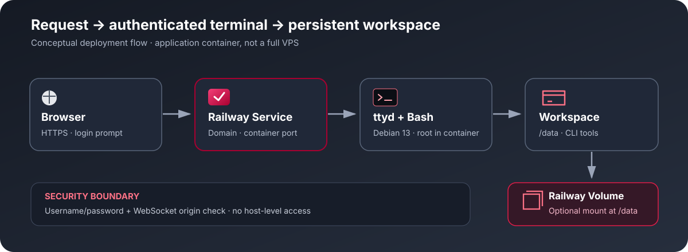

<div align="center">

<a href="https://www.debian.org/"></a>

# Debian Personal Railway

<p>
  <a href="https://github.com/DURIAN-ORGANISASI/debian-railway/actions/workflows/docker-build.yml"></a>
  
  
  
  <a href="LICENSE"></a>
</p>

<p><a href="README.md">🇮🇩 Bahasa Indonesia</a> · <a href="README.en.md">🇬🇧 English</a></p>

<p><strong>Terminal Debian 13 melalui browser, siap di-deploy ke Railway.</strong><br>
Gunakan shell Bash, tool CLI harian, banner informasi sistem, dan penyimpanan file opsional.</p>

<p>
  <a href="#coba-sekarang">Mulai cepat</a> ·
  <a href="#fitur">Fitur</a> ·
  <a href="#arsitektur-singkat">Arsitektur</a> ·
  <a href="#cara-pakai">Panduan penggunaan</a> ·
  <a href="#volume-persisten">Penyimpanan</a> ·
  <a href="#privasi-dan-keamanan">Privasi &amp; keamanan</a> ·
  <a href="#pengembangan">Pengembangan</a> ·
  <a href="#sumber-atribusi-dan-lisensi">Sumber &amp; lisensi</a> ·
  <a href="#kontribusi">Kontribusi</a> ·
  <a href="#keamanan-proyek">Keamanan</a>
</p>

</div>

---


<p align="center"><sub>Ilustrasi orisinal dokumentasi; bukan screenshot resmi Debian atau Railway.</sub></p>

> [!WARNING]
> **Bukan VPS penuh.** Railway menjalankan container aplikasi, bukan server virtual dengan akses ke host, desktop GUI, atau jaminan systemd penuh. Terminal web memberikan shell root di dalam container. Gunakan password kuat dan pahami bahwa siapa pun yang dapat login memiliki hak istimewa tinggi di container.

## Coba sekarang

1. Buka [repository Debian Personal Railway](https://github.com/DURIAN-ORGANISASI/debian-railway).
2. Di Railway, pilih **New Project → Deploy from GitHub Repo**, lalu pilih repository ini.
3. Pastikan build menggunakan `Dockerfile` di root repository.
4. Tambahkan `TERMINAL_USER` dan `TERMINAL_PASSWORD` di **Railway → Service → Variables**.
5. Tunggu deployment selesai, lalu buka **Settings → Networking → Generate Domain**.
6. Kunjungi domain dan login dengan kredensial yang dibuat. Untuk menjaga file setelah redeploy, ikuti [Volume persisten](#volume-persisten).

## Fitur

- **Debian 13 (Trixie)** sebagai image dasar.
- **Terminal browser** berbasis `ttyd` 1.7.7 dengan autentikasi username/password.
- Mendukung arsitektur **AMD64 dan ARM64** melalui binary ttyd yang sesuai.
- **Bash login shell** dengan banner informasi sistem otomatis.
- Informasi sistem mencakup distro, kernel, arsitektur, uptime, CPU, RAM, disk, shell, dan timezone.
- Tool CLI umum: Git, curl, Python 3, pip/venv, compiler/build tools, dan utilitas shell.
- Direktori kerja awal **`/data`**, dengan dukungan Railway Volume opsional.
- Zona waktu default **`Asia/Jakarta`**.
- Pemeriksaan origin WebSocket aktif; konfigurasi log ttyd menekan pesan NOTICE yang dapat memuat field kredensial.
- GitHub Actions membangun image dan menguji respons terminal beserta pemeriksaan kredensial pada log.

## Arsitektur singkat



Alur terminal:

1. Browser membuka domain HTTPS yang disediakan Railway.
2. `ttyd` meminta username dan password sebelum membuka sesi terminal.
3. Bash login shell memulai sesi dan menampilkan banner sistem.
4. Perintah berjalan di container Debian dengan direktori kerja awal `/data`.
5. Railway Volume opsional dipasang ke `/data` agar file tetap tersedia ketika container dibuat ulang.

## Cara pakai

### 1. Deploy ke Railway

1. Buat atau buka project Railway.
2. Pilih **New Project → Deploy from GitHub Repo**, lalu pilih `DURIAN-ORGANISASI/debian-railway`.
3. Gunakan `Dockerfile` di root repository. Custom Start Command biasanya tidak diperlukan karena image memiliki `ENTRYPOINT`.
4. Tambahkan variabel yang dibutuhkan seperti contoh di bawah.
5. Periksa **Build Logs** dan **Deploy Logs** untuk melihat hasil build serta runtime.
6. Buat domain melalui **Settings → Networking → Generate Domain**.
7. Buka domain dan login ketika browser meminta autentikasi.

### 2. Variabel Railway

Buka **Railway → Service → Variables**, kemudian tambahkan:

```dotenv
TERMINAL_USER=GANTI_DENGAN_USERNAME_UNIK
TERMINAL_PASSWORD=GANTI_DENGAN_PASSWORD_ACAK_MINIMAL_24_KARAKTER
TZ=Asia/Jakarta
```

| Variabel | Wajib | Keterangan |
| --- | --- | --- |
| `TERMINAL_USER` | Ya | Username login; tidak boleh mengandung titik dua (`:`). |
| `TERMINAL_PASSWORD` | Ya | Password unik minimal 16 karakter; 24–40 karakter atau lebih disarankan. |
| `TZ` | Tidak | Zona waktu; default `Asia/Jakarta`. |
| `PORT` | Otomatis | Railway menyediakan port service. Jangan hardcode di Variables; image memakai 8080 sebagai fallback lokal. |

Template lokal tersedia di [`.env.example`](.env.example). File tersebut bukan tempat menyimpan kredensial produksi. Jangan commit password asli, token, atau API key ke GitHub. Jika password bocor, ganti `TERMINAL_PASSWORD` di Railway Variables lalu restart atau redeploy service.

### 3. Menggunakan terminal

Setelah login, terminal membuka Bash dengan direktori kerja awal `/data`. Banner sistem muncul otomatis pada sesi login baru.

Contoh perintah:

```bash
cat /etc/os-release
python3 --version
git --version
pwd
date
df -h /data
```

Shell berjalan sebagai root **di dalam container**, bukan root host Railway. Tool Git, Python, pip/venv, curl, dan compiler sudah dipasang dalam image. `fastfetch` dipasang jika tersedia di repositori paket Debian; banner tetap memiliki tampilan cadangan jika tool tersebut tidak tersedia.

## Volume persisten

Filesystem container tidak dijamin bertahan setelah container dibuat ulang atau service di-redeploy. Untuk menjaga file kerja:

1. Buka **Railway → Service → Settings → Volumes → Add Volume**.
2. Tetapkan **Mount Path** tepat ke `/data`.
3. Simpan file yang ingin dipertahankan di dalam `/data`.

File di luar mount point tidak otomatis persisten. Volume juga bukan pengganti backup—salin file penting ke lokasi aman secara berkala.

## Troubleshooting

| Masalah | Yang perlu diperiksa |
| --- | --- |
| Deployment langsung berhenti | Pastikan `TERMINAL_USER` diisi dan tidak mengandung `:`; password wajib minimal 16 karakter. Periksa Deploy Logs. |
| Build gagal mengunduh ttyd atau paket | Periksa akses build ke GitHub Releases serta repositori paket Debian. |
| Domain terbuka tetapi terminal tidak muncul | Pastikan service aktif, domain mengarah ke service yang benar, dan aplikasi mendengarkan port `PORT` Railway. |
| Terminal/WebSocket gagal di browser | Buka domain HTTPS secara langsung, jangan embed dari origin lain, dan periksa runtime logs. |
| Banner tidak terlihat | Buka sesi terminal baru dan pastikan shell yang berjalan adalah Bash login interaktif. |
| File hilang setelah redeploy | Pasang Volume tepat di `/data` dan simpan file di dalam direktori tersebut. |
| Password perlu diganti | Ubah `TERMINAL_PASSWORD` di Railway Variables, lalu restart atau redeploy service. |

## Privasi dan keamanan

- **Lindungi domain publik.** Gunakan password unik yang kuat. Pertimbangkan lapisan akses tepercaya jika terminal memuat data sensitif.
- **Hak root di container.** Perintah memiliki hak istimewa tinggi di container. Periksa perintah sebelum menjalankannya; ini bukan akses root ke host Railway.
- **Jaga kredensial.** Jangan simpan password, API key, token bot, atau konfigurasi rahasia di repository, screenshot, maupun log publik.
- **Log ttyd.** ttyd dijalankan pada debug level 3 untuk menekan NOTICE yang dapat menyertakan field kredensial. ERROR/WARN tetap aktif; ini bukan jaminan keamanan menyeluruh.
- **Origin WebSocket.** `--check-origin` membatasi koneksi WebSocket dari browser dengan origin yang tidak sesuai, tetapi tidak menggantikan autentikasi.
- **Volume.** Hanya data pada mount point yang dikonfigurasi yang dipertahankan sesuai aturan Volume. Lindungi akses ke project dan backup.
- **Batas platform.** systemd penuh, Docker-in-Docker, akses kernel host, desktop GUI, dan semua daemon tradisional tidak dijamin tersedia.
- **Sumber upstream.** Build memerlukan akses jaringan ke image Debian, GitHub Releases, dan repositori paket. Ketersediaan sumber upstream dapat berubah.

## Pengembangan

Clone repository dan bangun image secara lokal:

```bash
git clone https://github.com/DURIAN-ORGANISASI/debian-railway.git
cd debian-railway
docker build --tag debian-personal-railway .
```

GitHub Actions membangun image dan menjalankan smoke test: container harus melayani halaman terminal dengan autentikasi, sementara log tidak boleh memuat password pengujian atau bentuk Base64-nya. Lolos CI tidak membuktikan bahwa deployment live di Railway sudah berhasil.

### Struktur repository

```text
debian-railway/
├── Dockerfile
├── entrypoint.sh
├── system-banner.sh
├── .dockerignore
├── .gitignore
├── .env.example
├── LICENSE
├── README.md
├── README.en.md
├── CONTRIBUTING.md
├── SECURITY.md
├── docs/
│   ├── hero.id.svg
│   ├── hero.en.svg
│   ├── architecture.svg
│   ├── architecture.en.svg
│   └── SOURCES.md
└── .github/
    └── workflows/
        └── docker-build.yml
```

## Sumber, atribusi, dan lisensi

Sumber upstream, atribusi aset visual, serta cakupan lisensi dijelaskan dalam [`docs/SOURCES.md`](docs/SOURCES.md).

- **Repository ini:** materi proyek yang tercakup dirilis di bawah [MIT License](LICENSE).
- **Logo Debian:** menggunakan logo *open-use* resmi dari Debian. Hak cipta dan syarat penggunaannya mengikuti lisensi logo upstream; penggunaannya tidak berarti proyek ini didukung secara resmi oleh Debian.
- **ttyd:** binary terminal web berasal dari [tsl0922/ttyd](https://github.com/tsl0922/ttyd), dengan lisensi upstream tersendiri.
- **Railway dan Docker:** merek dagang serta layanan tetap milik pemilik masing-masing.
- Dependensi sistem dan paket pihak ketiga tunduk pada lisensi masing-masing. MIT pada repository ini tidak menggantikan lisensi upstream.

## Kontribusi

Issues dan Pull Requests dipersilakan. Baca [`CONTRIBUTING.md`](CONTRIBUTING.md) sebelum mengajukan perubahan. Jangan sertakan password, token, API key, atau log yang mengandung rahasia.

## Keamanan proyek

Untuk melaporkan potensi kerentanan, ikuti [`SECURITY.md`](SECURITY.md). Hindari memublikasikan detail domain privat, password terminal, atau kredensial deployment.

## Lisensi

Materi proyek yang tercakup dirilis di bawah [MIT License](LICENSE). Logo Debian, ttyd, dependensi sistem, Railway, serta layanan pihak ketiga tetap tunduk pada ketentuan masing-masing.

---

<div align="center">
  <sub>Debian Personal Railway — terminal Debian praktis berbasis browser, dengan penyimpanan persisten opsional.</sub>
</div>
